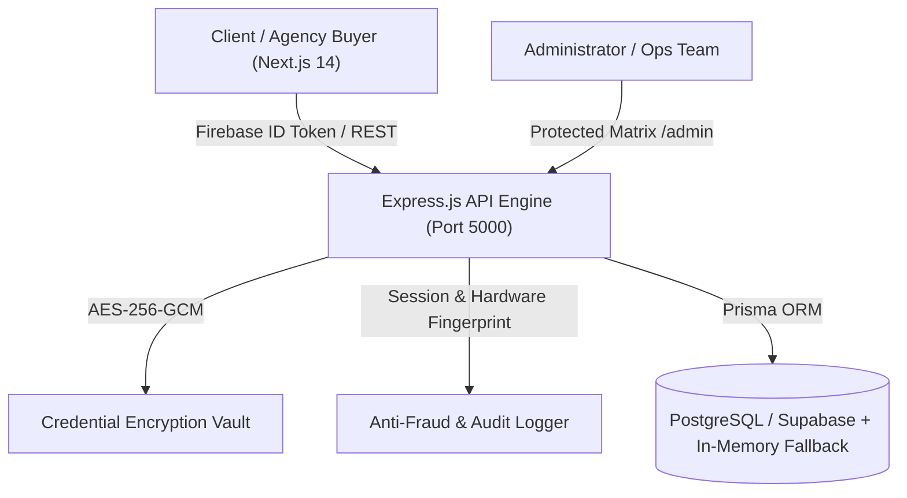

# AdBez Advertising Agency Portal — Architecture & Operational Analysis

## 1. System Overview
**AdBez Advertising** is an institutional-grade advertising account marketplace and management platform designed for high-spend digital marketing agencies, media buyers, and enterprise advertisers. It provides instant procurement, escrowed wallet management, hardware/network footprint audit trails, and AES-256-GCM encrypted credential delivery for ad infrastructure assets.

---

## 2. Technology Stack Breakdown

| Layer | Technologies & Libraries | Function |
| :--- | :--- | :--- |
| **Frontend** | Next.js 14 (App Router), React 18, TypeScript, Tailwind CSS, Framer Motion, Lucide Icons, Zustand | High-performance reactive UI with client/admin dashboards, cart pipeline, real-time filters |
| **Authentication** | Firebase Auth (Client SDK + Admin SDK), Google OAuth, Email/Password | Multi-provider authentication with token verification and backend user synchronization |
| **Backend API** | Node.js (v24), Express 4, Helmet, CORS, Express-Rate-Limit, Compression | Secure REST API gateway with rate limiting, sanitization, and request auditing |
| **Database & ORM** | Prisma ORM 5.22, PostgreSQL (Supabase pooler + direct host) | Relational schema with ACID compliance, role-based access control, and transaction items |
| **Security & Cryptography** | `crypto` (AES-256-GCM), bcryptjs, xss | Zero-knowledge credential isolation, 2FA backup masking, session fingerprinting |
| **Anti-Fraud & Telemetry** | Canvas hashing, screen resolution, timezone, WebGL, server-validated IP/ISP | Audit trails against multi-accounting, VPN spoofing, and malicious traversal |

---

## 3. Core Modules & Operational Workflows

### 3.1 Asset Catalog & Marketplace
- **Categories Supported**:
  1. `Agency Ad Accounts` (Meta, Google Ads MCC, TikTok, Bing) with credit lines up to $250,000.
  2. `FB Profiles` (Warmed, identity-reinstated, KYC-cleared, warm cookies).
  3. `Business Managers` (Standard BM1, BM3, WhatsApp Business API nodes).
  4. `Verified BMs` (Corporate verified, 5-node, 10-node, uncapped daily spend caps).
  5. `Niche Pages` (Pre-warmed Web3, Crypto, iGaming / high-compliance structures).
- **Search & Filtering**: Multi-parameter search by platform, country flag, price range, daily spend cap, and keyword search.

### 3.2 Cart Pipeline & Instant Provisioning
- **Zustand Cart State**: Persistent procurement drawer with quantity control and automated volume discount calculations (e.g., 5% bonus for 5+ assets).
- **Wallet Deductions & Checkout**: Direct escrow deduction from user wallet balance, triggering immediate transaction record creation and credential decrypting for the buyer.
- **Post-Purchase Asset Delivery (`/orders` & `/checkout?id=...`)**:
  - Encrypted Credentials: Username, Password, 2FA recovery backup codes, and setup notes.
  - Proxy Routing Nodes: Pre-configured HTTP/SOCKS5 proxy endpoints.
  - Recovery & Cookie Files: Downloadable JSON session payloads.

### 3.3 Security & Anti-Fraud Matrix (`/admin/footprint`)
- Collects canvas hash, user-agent, display geometry, timezone, server-validated IP vs. client IP (heuristic VPN detection), and session navigation paths.
- Provides compliance audits to detect fraudulent transactions and unauthorized account access.

### 3.4 Administrative Control Zone (`/admin`)
- **Protected Access**: Enforced via `AdminLayout` and backend `authenticate` middleware with an exact email whitelist (`admin.adbez@gmail.com`, `admin@adbez.com`, `admin2@adbez.com`, `root@adbez.com`, `trushalpalpvt@gmail.com`).
- **Control Modules**:
  - `Inventory Control`: Add, edit, bulk CSV/JSON import, toggle stock status, edit AES-256 credentials.
  - `User Management`: View all registered users, adjust wallet balances, elevate client accounts to admins.
  - `Transaction Ledger`: Real-time transaction statuses (`PENDING`, `COMPLETED`, `FLAGGED`, `REFUNDED`).
  - `User Requests`: Approve or deny balance top-ups and custom account applications.

---

## 4. Live Execution Status

Both services are currently active, running in background daemon processes:

| Service | Target Port | Status | Health / Response |
| :--- | :--- | :--- | :--- |
| **Backend API** | `http://localhost:5000` | **ONLINE** | `GET /health` -> `200 OK` (`AdBez Systems API Operational`) |
| **Frontend Web App** | `http://localhost:3000` | **ONLINE** | `GET /` -> `200 OK` (Next.js 14 ready in 8.6s) |
| **API Accounts Endpoint** | `http://localhost:5000/api/accounts` | **ONLINE** | Returns 20 institutional assets |
| **API Category Stats** | `http://localhost:5000/api/accounts/stats` | **ONLINE** | Real-time counts across all 5 infrastructure categories |

### Interactive Browser Verification
- **Desktop Homepage**: Loaded cleanly with the header, dark/light theme toggle, and hero banner.
- **Catalog & Filter Tabs**: Switched between *All Assets (20)*, *Ad Accounts (5)*, *FB Profiles (4)*, *Business Managers (3)*, and *Verified BMs (6)*.
- **Cart Drawer**: Successfully added assets, updated item count badge in the navigation bar, and calculated pricing subtotals.
- **Authentication**: Verified both client sign-in (`/login`) and admin gate (`/admin-login` and `/admin`).
